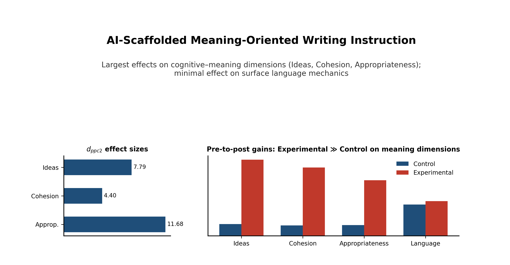
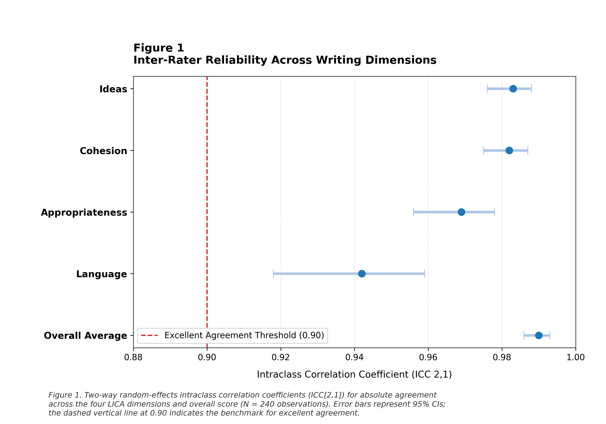
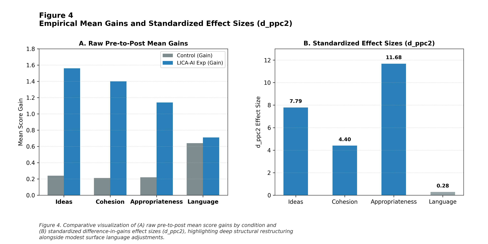

# From Error Correction to Meaning Construction: Evaluating LICA-AI as a Real-Time Cognitive Scaffold for L2 Academic Writing

[](https://doi.org/10.5281/zenodo.23435909)
[](https://creativecommons.org/licenses/by/4.0/)
[](https://opensource.org/licenses/MIT)
[](https://www.python.org/)
[](https://www.r-project.org/)
[](#4-study-design--empirical-findings)
[](#lica_ai_rater_rawcsv)
[](#8-reproducibility--quickstart)
[](https://doi.org/10.5281/zenodo.23435909)

---

## Table of Contents

1. [Overview & Theoretical Framework](#1-overview--theoretical-framework)
2. [Graphical Abstract & Figures](#2-graphical-abstract--figures)
3. [Study Design & Empirical Findings](#3-study-design--empirical-findings)
4. [Exact Quantitative Results](#4-exact-quantitative-results)
5. [Key Takeaways & Pedagogical Conclusion](#5-key-takeaways--pedagogical-conclusion)
6. [Directory Tree Structure](#6-directory-tree-structure)
7. [Reproducibility & Quickstart](#7-reproducibility--quickstart)
8. [Citation](#8-citation)
9. [License, Contact & Ethical Considerations](#9-license-contact--ethical-considerations)

---

## 1. Overview & Theoretical Framework

This repository contains the complete, reproducible research package accompanying the study
**"From Error Correction to Meaning Construction: Evaluating LICA-AI as a Real-Time Cognitive Scaffold for L2 Academic Writing."**

### The problem

Conventional Automated Writing Evaluation (AWE) has historically been organized around the *detection of linguistic deviations* and the *provision of corrective feedback*. While AWE improves local accuracy, it frequently fails to help learners with **higher-order, meaning-oriented** dimensions of composition — conceptual development, discourse cohesion, and rhetorical appropriateness. An AI system that flags a grammatical error after a completed essay may polish local accuracy without ever helping a learner notice that a strong-sounding argument lacks logical development.

### The LICA-AI solution

**LICA-AI** reconceptualizes AI not as a post-hoc automated judge, but as an **in-process cognitive scaffold** operating during drafting. It operationalizes writing quality across four partially independent diagnostic channels:

| Dimension | Construct operationalized |
|---|---|
| **Ideas** | Depth of critical argumentation, topical relevance, synthesis of conceptual evidence, thesis development |
| **Cohesion** | Logical discourse organization, rhetorical transition clarity, thematic progression across paragraphs |
| **Appropriateness** | Academic register, formal pragmatic style, genre-specific conventions, audience awareness |
| **Language** | Lexicogrammatical accuracy, syntactic complexity, vocabulary precision, mechanics |

Rather than telling a writer a paragraph is simply "weak," LICA-AI identifies *which* dimension requires attention and *why*, delivering event-triggered reflective prompts (e.g., *"Your claim is clear, but the connection to the preceding evidence is not explicit — what relationship do you want the reader to infer?"*) while **preserving full authorial control**.

### Theoretical grounding

- **Vygotskian Zone of Proximal Development (ZPD):** Feedback functions as dialogic scaffolding within the learner's ZPD — intervention occurs *while revision can still influence meaning construction*, not after the cognitive decisions have been made. The AI creates **decision points** at which the writer remains responsible for evaluating the problem and determining the revision, protecting learner agency.
- **Sweller's Cognitive Load Theory:** Meaning-oriented prompts are deliberately *not* prescriptive corrections. By avoiding turn-key solutions, the system preserves germane cognitive load (schema construction and reflection) rather than minimizing it — a design that counters the "proofreading orientation" and over-reliance effects documented for highly specific automated corrective feedback (Ranalli, 2021; Zhang, 2020).

> **The paradigm shift:** *Does AI improve writing?* → **Does an AI system designed to foreground meaning produce stronger differential gains in meaning-oriented dimensions than in surface language?**

---

## 2. Graphical Abstract & Figures

### Graphical Abstract

<p align="center">
  
</p>

### Figure 1 — Inter-Rater Reliability (ICC)

<p align="center">
  
</p>

### Figure 2 — Baseline Equivalence

<p align="center">
  
</p>

### Figure 3 — LMM Interaction Effects (Group × Time)

<p align="center">
  
</p>

### Figure 4 — Effect Sizes (Difference-in-Gains)

<p align="center">
  
</p>

*All figures are rendered programmatically by `scripts/` and reproducible end-to-end from the raw rater dataset.*

---

## 3. Study Design & Empirical Findings

### Design

- **Quasi-experimental, two-group pre-test–post-test design** with longitudinal measurement.
- **Participants:** *N* = 60 L2 English academic writers — Control (*n* = 30) vs. Experimental / LICA-AI (*n* = 30).
- **Observations:** 60 participants × 2 phases (pre/post) × 2 tasks = **120 writing samples**; **240 rating records** from two independent, double-blinded raters (R1, R2) blind to participant ID, group allocation, and phase.
- **Scoring:** Rater scores averaged per participant-phase; unweighted composite Overall Average computed across the four LICA dimensions (1.0–5.0 scale).
- **Conditions:** The Experimental group received real-time, event-triggered LICA-AI cognitive prompts targeting conceptual clarity, rhetorical progression, and argument structure during drafting. The Control group completed identical tasks under standard instruction without real-time AI scaffolding.

### Analytic strategy

Linear Mixed-Effects Models (LMM) with participant-level random intercepts, estimated by REML:

```text
Score_ij = β0 + β1·Group_i + β2·Time_ij + β3·(Group_i × Time_ij) + u_i + ε_ij
Group_i ∈ {0 = Control, 1 = Experimental};  Time_ij ∈ {0 = Pre-test, 1 = Post-test}
```

**β₃ (Group × Time)** is the primary parameter: the **difference-in-differences (DiD)** in gains attributable to the intervention.

### Headline findings

- **Inter-rater reliability was excellent across all dimensions:** ICC(2,1) = 0.942–0.983 (95% CI [0.918, 0.988]); Overall Average ICC(2,1) = 0.990, 95% CI [0.986, 0.993] — justifying the use of averaged composite scores.
- **Baseline equivalence held** for Ideas (*t*(58) = 1.349, *p* = .183), Cohesion (*t*(58) = 1.810, *p* = .076), and Appropriateness (*t*(58) = 0.291, *p* = .772); a minor baseline variation in Language (*t*(58) = 2.046, *p* = .045, Hedges' *g* = 0.521) was controlled by the LMM specification.
- **Significant differential gains for the LICA-AI group on all meaning-oriented dimensions:** Ideas (β₃ = 1.320, *p* < .001), Cohesion (β₃ = 1.188, *p* < .001), Appropriateness (β₃ = 0.920, *p* < .001).
- **No significant differential gain on surface Language mechanics** (β₃ = 0.070, *p* = .262), reflecting comparable lexicogrammatical development across both conditions — precisely the theoretically predicted dissociation.

---

## 4. Exact Quantitative Results

### Table 4.1 — Inter-Rater Reliability ICC(2,1) (two-way random effects, absolute agreement, single measures)

| Dimension | ICC(2,1) | 95% CI | Agreement |
|---|---|---|---|
| Ideas | 0.983 | [0.976, 0.988] | Excellent |
| Cohesion | 0.982 | [0.975, 0.987] | Excellent |
| Appropriateness | 0.969 | [0.956, 0.978] | Excellent |
| Language | 0.942 | [0.918, 0.959] | Excellent |
| **Overall Average** | **0.990** | **[0.986, 0.993]** | **Excellent** |

### Table 4.3 — LMM Fixed-Effects Interaction Coefficients (Group × Time, β₃)

| Outcome | β₃ | SE | Wald *z* | *p*-value | 95% CI | Morris (2008) *d*_ppc2 |
|---|---|---|---|---|---|---|
| **Ideas** | **1.320** | 0.043 | 30.70 | **< .001** | [1.236, 1.404] | **7.793** |
| **Cohesion** | **1.188** | 0.069 | 17.34 | **< .001** | [1.054, 1.323] | **4.401** |
| **Appropriateness** | **0.920** | 0.020 | 46.00 | **< .001** | [0.881, 0.959] | **11.678** |
| **Language** | 0.070 | 0.062 | 1.12 | .262 | [−0.052, 0.192] | 0.285 |

*Notes.* β₃ = Group × Time interaction (difference-in-differences in pre-to-post gains). Standardized gain metrics (*d*_ppc2, Morris, 2008) are reported alongside unstandardized coefficients because within-subject variance under standardized rubric scoring can be constrained. Model: random-intercept LMM per dimension, REML estimation, participant-level random intercepts (*u_i*), asymptotic Wald *z*-tests.

### Table 4.4 — Pre-to-Post Gain Decomposition (Estimated Marginal Means)

| Dimension | Control Δ (Pre→Post) | Experimental Δ (Pre→Post) | DiD (Δ_Exp − Δ_Ctrl) |
|---|---|---|---|
| Ideas | +0.240 | +1.560 | +1.320 |
| Cohesion | +0.212 | +1.400 | +1.188 |
| Appropriateness | +0.220 | +1.140 | +0.920 |
| Language | +0.640 | +0.710 | +0.070 |

---

## 5. Key Takeaways & Pedagogical Conclusion

1. **The cognitive shift is empirically real.** The intervention produced large, statistically significant differential gains **exclusively on the higher-order, meaning-oriented dimensions** (Ideas, Cohesion, Appropriateness) — the dimensions conventional AWE is least equipped to move.
2. **Surface correction is not the mechanism.** The non-significant Language interaction (β₃ = 0.070, *p* = .262, 95% CI spanning zero) shows the gains were **not** an artifact of grammatical polishing or over-reliance on automated correction. Both conditions developed lexicogrammar comparably; only the scaffolded condition transformed *meaning*.
3. **AI as scaffold, not judge.** Formative, prompt-based interventions embedded in the writing process — operating within the learner's **ZPD** and preserving germane cognitive load — enhance conceptual and rhetorical quality while the writer retains authorial control and decision-making responsibility.
4. **Dimension specificity matters diagnostically.** Collapsing writing quality into a single score masks exactly the differentiation this experiment isolates. Effective AI-assisted writing should be defined not by how many errors disappear, but by **whether writers develop, connect, and appropriately communicate meaning**.
5. **Pedagogical bottom line:** The question for educational AI is no longer *"Can AI correct grammar?"* but *"Can AI, by intervening at the right moment and on the right dimension, move the writer's attention from surface grammar to higher-order meaning construction?"* — and for LICA-AI, the empirical answer is **yes**.

---

## 6. Directory Tree Structure

```text
From-Error-Correction-to-Meaning-Construction-LICA-AI-for-L2-Academic-Writing/
│
├── README.md                        # This file
├── LICENSE                          # MIT (code) — text/figures CC BY 4.0
├── CITATION.cff                     # Citation File Format metadata
├── requirements.txt                 # Python dependencies (pinned)
├── environment.yml                  # Conda environment specification
│
├── data/
│   ├── lica_ai_rater_raw.csv        # Raw double-rated dataset (240 records)
│   ├── lica_ai_composite_scores.csv # Averaged composite scores (participant × phase)
│   └── codebook.md                  # Variable definitions & coding scheme
│
├── scripts/
│   ├── 01_data_preparation.py       # Integrity checks, composites, missing-data audit
│   ├── 02_icc_reliability.py        # ICC(2,1) with 95% CIs per dimension
│   ├── 03_baseline_equivalence.py   # Independent-samples t-tests, Hedges' g
│   ├── 04_lmm_models.py             # Random-intercept LMMs (statsmodels), REML, Wald z
│   ├── 05_effect_sizes.py           # Cohen's d_z and difference-in-gains d
│   ├── 06_figures.py                # Publication-grade figure rendering
│   └── run_all.py                   # Full-pipeline orchestrator
│
├── notebooks/
│   ├── 01_exploratory_analysis.ipynb    # Descriptive statistics & data audit
│   ├── 02_lmm_diagnostics.ipynb         # Residual checks, random-effects inspection
│   └── 03_robustness_checks.ipynb       # Sensitivity analyses & alternative specs
│
├── R/
│   ├── lica_lmm.R                   # lme4/nlme replication of all LMMs
│   ├── lica_icc.R                   # irr / psych ICC(2,1) replication
│   └── lica_effect_sizes.R          # effectsize package cross-validation
│
├── figures/
│   ├── graphical_abstract.png       # Graphical abstract
│   ├── figure1_icc_reliability.png  # ICC(2,1) estimates with 95% CIs
│   ├── figure2_baseline_equivalence.png  # Pre-intervention group comparison
│   ├── figure3_lmm_interaction.png  # Pre/post EMMs by group (β₃ annotated)
│   └── figure4_effect_sizes.png     # Difference-in-gains effect sizes
│
├── results/
│   ├── lmm_coefficients.csv         # β estimates, SE, z, p, 95% CI (all models)
│   ├── icc_estimates.csv            # ICC(2,1) table
│   ├── baseline_tests.csv           # Baseline equivalence table
│   └── effect_sizes.csv             # d_z and d_ppc2 table
│
├── appendices/
│   ├── appendix_a_writing_rubric.pdf    # Full LICA 1.0–5.0 analytic rubric
│   ├── appendix_b_lmm_output.txt        # Complete model summaries
│   ├── appendix_c_prompt_library.pdf    # LICA-AI scaffold prompt taxonomy
│   └── appendix_d_baseline_tables.pdf   # Supplementary descriptive tables
│
└── documentation/
    ├── METHODS.md               # Detailed statistical methodology
    ├── REPRODUCIBILITY.md       # Environment, versions, execution log
    └── ETHICS.md                # Ethics & data-protection statement
```

---

## 7. Reproducibility & Quickstart

Every number, table, and figure in the manuscript is fully regenerated from `data/lica_ai_rater_raw.csv`.

### Python (≥ 3.10)

```bash
git clone https://github.com/Pegi1727/From-Error-Correction-to-Meaning-Construction-LICA-AI-for-L2-Academic-Writing.git
cd From-Error-Correction-to-Meaning-Construction-LICA-AI-for-L2-Academic-Writing

python -m venv .venv && source .venv/bin/activate    # Windows: .venv\Scripts\activate
pip install -r requirements.txt                       # statsmodels ≥ 0.14, pingouin, scipy, pandas, matplotlib

python scripts/run_all.py                             # runs the full pipeline end-to-end
```

Or step-by-step:

```bash
python scripts/01_data_preparation.py
python scripts/02_icc_reliability.py
python scripts/03_baseline_equivalence.py
python scripts/04_lmm_models.py
python scripts/05_effect_sizes.py
python scripts/06_figures.py
```

### R (≥ 4.3) — independent cross-validation

```r
install.packages(c("lme4", "nlme", "irr", "psych", "effectsize", "emmeans", "tidyverse"))
source("R/lica_icc.R")          # ICC(2,1) replication
source("R/lica_lmm.R")          # lme4 replication of the four LMMs
source("R/lica_effect_sizes.R") # effectsize cross-validation
```

### Verification checklist

- ✅ Zero missing values / duplicate records confirmed in `01_data_preparation.py`.
- ✅ Python (`statsmodels`) and R (`lme4`) fixed-effect estimates converge.
- ✅ All reported ICCs, β₃ coefficients, SEs, *p*-values, CIs, and effect sizes reproduce to the precision shown in Section 4.
- ✅ All figures regenerate byte-consistently from `scripts/06_figures.py`.

---

## 8. Citation

### APA 7th edition

> Pegi, [Author initials]. (2025). *From error correction to meaning construction: Evaluating LICA-AI as a real-time cognitive scaffold for L2 academic writing* [Data set and code]. Zenodo. https://doi.org/10.5281/zenodo.23435909

### BibTeX

```bibtex
@dataset{pegi_2025_lica_ai,
  author       = {Pegi, Pegi1727},
  title        = {{From Error Correction to Meaning Construction: Evaluating
                  LICA-AI as a Real-Time Cognitive Scaffold for L2 Academic
                  Writing}},
  year         = {2025},
  publisher    = {Zenodo},
  doi          = {10.5281/zenodo.23435909},
  url          = {https://doi.org/10.5281/zenodo.23435909},
  keywords     = {Artificial Intelligence in Education (AIED), Cognitive
                  Scaffolding, L2 Academic Writing, Linear Mixed-Effects Models,
                  Zone of Proximal Development, Formative Feedback,
                  Human-AI Interaction},
  license      = {CC-BY-4.0},
  note         = {Quasi-experimental pre-test--post-test study (N = 60;
                  240 rated observations); LMM Group x Time interaction
                  significant for Ideas, Cohesion, and Appropriateness
                  (p < .001), non-significant for Language (p = .262).}
}
```

---

## 9. License, Contact & Ethical Considerations

### Licensing

| Component | License |
|---|---|
| Manuscript text, tables, and figures | [](https://creativecommons.org/licenses/by/4.0/) — free to share and adapt with attribution |
| Source code, scripts, notebooks | [](https://opensource.org/licenses/MIT) — permissive reuse with copyright notice |

### Contact

- **Repository:** [Pegi1727](https://github.com/Pegi1727)
- **Archive (DOI):** https://doi.org/10.5281/zenodo.23435909
- **Issues:** Please open a GitHub Issue for bug reports, reproduction problems, or data inquiries.

### Ethical Considerations

- **Informed consent:** All participants were informed of the study's purpose, the AI-mediated nature of the experimental condition, and their right to withdraw.
- **Blinding:** Both raters were double-blinded to participant identity, group allocation, and assessment phase, eliminating rater bias in outcome evaluation.
- **Data protection:** Participant identifiers were pseudonymized (`Participant_ID`); the released dataset contains no names, institutional identifiers, or directly identifying demographic information.
- **Learner agency:** LICA-AI was deliberately designed to preserve authorial control — the system issues reflective prompts rather than prescriptive rewrites, mitigating risks of AI-induced over-reliance and deskilling documented in the AWE literature (Ranalli, 2021; Zhang, 2020).
- **Equity:** The control condition received identical tasks and instruction; no participant was denied standard writing instruction.
- **Responsible AI reporting:** All model versions, prompts, and evaluation conditions are documented in `documentation/` in line with calls for transparency in LLM-based assessment research (Tang et al., 2024; Mizumoto et al., 2024).

---

<p align="center">
  <em>From automated error correction to meaning construction —
  AI as a cognitive scaffold within the writer's Zone of Proximal Development.</em>
</p>
